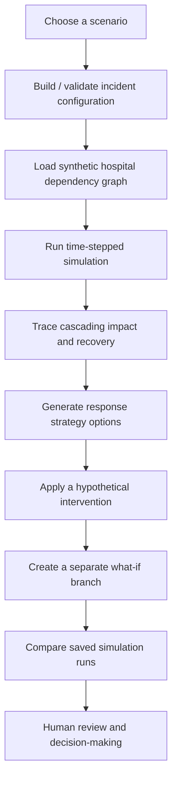
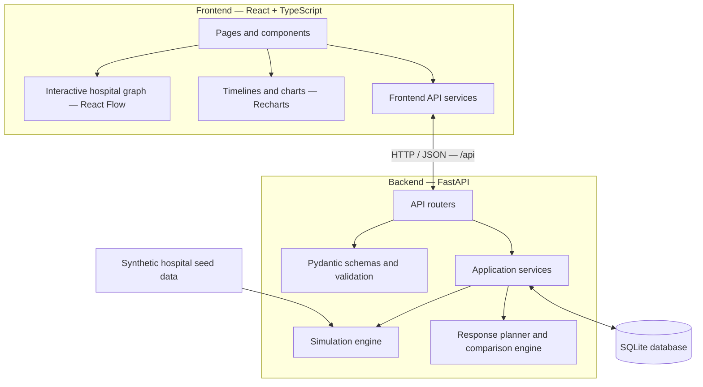
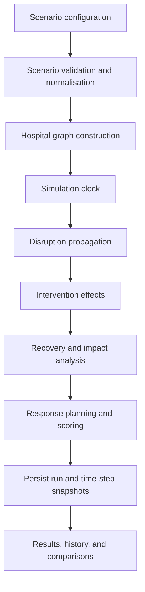

# PulseGrid
### AI-Powered Hospital Resilience & Emergency Decision Support System
**Keeping Critical Care Connected.**

<p align="center">
  <strong>Model disruptions. Understand cascading impact. Compare response strategies.</strong>
</p>

> [!IMPORTANT]
> **Prototype / demo environment — synthetic data only.** PulseGrid is a decision-support prototype. It does not control hospital infrastructure or medical devices, make clinical decisions, or represent a deployed hospital system. Every recommendation is a simulated suggestion that requires human review and authorisation.
>
> “AI” in this project refers to explainable graph algorithms and transparent scoring. **No trained machine-learning model is used.**

---

## Contents
- [Overview](#overview)
- [The problem](#the-problem)
- [How PulseGrid works](#how-pulsegrid-works)
- [Key features](#key-features)
- [System architecture](#system-architecture)
- [Technology stack](#technology-stack)
- [Getting started](#getting-started)
- [API overview](#api-overview)
- [Simulation engine](#simulation-engine)
- [Response strategy scoring](#response-strategy-scoring)
- [Synthetic data and assumptions](#synthetic-data-and-assumptions)
- [Testing status](#testing-status)
- [Known limitations](#known-limitations)
- [Demo walkthrough](#demo-walkthrough)

---

## Overview

Hospitals depend on interconnected infrastructure and services. A failure in one system can affect several others, potentially disrupting critical departments.

**PulseGrid models these dependencies as a graph**, simulates how disruptions propagate over time, and lets users explore hypothetical interventions and compare response strategies under finite resource constraints.

The central workspace is the **Simulation Lab**, supported by a hospital dependency map, response planner, scenario library, simulation history, and comparison tools.

## The problem

A hospital disruption is rarely isolated. For example, a main power failure may affect power distribution, oxygen compressors, IT systems, HVAC, and eventually departments such as the ICU, emergency department, and operating theatres.

Planners need a way to:
- See which services depend on a disrupted system.
- Understand how an incident may cascade over time.
- Explore response options before choosing an action.
- Compare the potential impact of different strategies.
- Account for limited resources rather than assuming unlimited backup capacity.

## How PulseGrid works



The simulation engine computes the results. The interface presents the timeline, affected systems, resource use, and strategy trade-offs so a human can review them.

## Key features

| Area | What it provides |
|---|---|
| **Dashboard** | Hospital status overview, key indicators, and recent simulation activity |
| **Hospital Map** | Interactive dependency graph with filters and a node inspector |
| **Simulations** | Create and review disruption scenarios |
| **Simulation Results** | Timeline, impact summaries, affected systems, and recovery information |
| **Response Planner** | Compare strategies, resource constraints, feasibility, and scores |
| **Scenario Library** | Browse predefined scenarios and incident types |
| **Simulation History** | Search and sort saved runs |
| **Settings** | Configure durations, scoring weights, and display settings |
| **Simulation Lab** | Build multi-disruption scenarios, run and control the timeline, inspect nodes, and test hypothetical interventions |
| **Scenario Comparison** | Compare 2–6 saved runs across impact, system states, resource use, recovery, and strategy scores |

### Simulation Lab highlights

- Five-minute simulation steps computed by the backend.
- Play, pause, resume, step, restart, and playback-speed controls.
- Cascade highlighting, node impact history, and event feed.
- Recovery view.
- Hypothetical interventions at a paused time step.
- What-if branches that preserve the original run rather than overwriting it.
- Saved snapshots that allow runs to be replayed.

---

## System architecture

### High-level architecture



### Backend engine flow



### Project structure

```text
backend/
└── app/
    ├── main.py
    ├── database.py
    ├── routers/
    │   └── api.py
    ├── schemas/
    │   └── api.py
    ├── services/
    │   ├── simulation_service.py
    │   └── settings_service.py
    ├── engine/
    │   ├── hospital_graph.py
    │   ├── scenario_definitions.py
    │   ├── scenario_builder.py
    │   ├── simulation_clock.py
    │   ├── propagation_engine.py
    │   ├── intervention_engine.py
    │   ├── recovery_engine.py
    │   ├── impact_analysis.py
    │   ├── response_planner.py
    │   ├── comparison_engine.py
    │   └── runner.py
    ├── seed/
    │   └── hospital_seed.py
    └── tests/

frontend/
└── src/
    ├── pages/
    ├── components/
    ├── services/
    ├── hooks/
    ├── types/
    └── utils/
```

**Persistence note:** The application uses Python's built-in `sqlite3` module through a small repository class in `backend/app/database.py`. It does **not** use SQLAlchemy. SQL operations are centralised in that file. SQLite is sufficient for this local prototype; a production deployment would require a separate architecture and security review.

---

## Technology stack

| Layer | Technologies |
|---|---|
| Frontend | React 18, TypeScript, Vite |
| Styling and navigation | Tailwind CSS 3, React Router |
| Graph visualisation | `@xyflow/react` |
| Charts | Recharts |
| Icons | `lucide-react` |
| Backend API | Python 3.12, FastAPI |
| Validation | Pydantic v2 |
| Graph modelling | NetworkX |
| Persistence | SQLite via Python `sqlite3` |

---

## Getting started

### Prerequisites

- Python 3.12
- Node.js and npm
- Git (optional)

### 1. Start the backend

Open a terminal in the project directory:

```bash
cd backend

# Create a virtual environment
python -m venv .venv

# Activate it — Windows PowerShell
.venv\Scripts\Activate.ps1

# macOS / Linux
# source .venv/bin/activate

# Install backend dependencies
pip install -r requirements.txt

# Optional environment configuration
# Copy .env.example to .env if you need to customise settings

# Start the API server
python -m uvicorn app.main:app --reload --port 8000
```

Backend API documentation:
- Swagger UI: http://127.0.0.1:8000/docs
- ReDoc: http://127.0.0.1:8000/redoc

### 2. Start the frontend

Open a **second terminal** and run:

```bash
cd frontend
npm install
npm run dev
```

Open the frontend at:

**http://localhost:5173**

The Vite development server proxies `/api` requests to the backend at port `8000`.

### 3. Database setup

The SQLite database file and required tables are created automatically when the backend starts for the first time. No external database server, paid API, or third-party cloud service is required for the demo.

> Keep both development terminals running while using the application.

---

## API overview

All application endpoints are under `/api`.

| Method | Endpoint | Purpose |
|---|---|---|
| GET | `/health` | Health / liveness check |
| GET | `/hospital/model` | Synthetic hospital model |
| GET | `/hospital/nodes` | Hospital graph nodes |
| GET | `/hospital/edges` | Dependency edges |
| GET | `/dashboard/summary` | KPIs, system status, and recent runs |
| GET | `/scenarios` | Scenario catalogue |
| GET | `/scenarios/{id}` | Scenario details |
| GET | `/incident-types` | Available incident types |
| GET | `/interventions` | Available interventions |
| POST | `/simulations` | Validate, run, and persist a simulation |
| POST | `/simulations/validate` | Validate a scenario without running it |
| GET | `/simulations` | Search, filter, sort, and list saved runs |
| GET | `/simulations/{id}` | Retrieve a saved run and its timeline |
| DELETE | `/simulations?confirm=true` | Clear simulation history |
| POST | `/response-plans` | Compute a response plan for a saved run |
| GET | `/response-plans/{id}` | Retrieve a response plan |
| POST | `/comparisons` | Compare 2–6 saved simulations |
| GET / PUT | `/settings` | Read or update settings |
| POST | `/demo/reset` | Reset the demo |
| POST | `/demo/clear-incident` | Clear the dashboard incident |

Simulation creation can include `parent_id` and `branch_label` to create a what-if branch.

API errors follow a consistent structure:

```json
{
  "error": {
    "code": "ERROR_CODE",
    "message": "Human-readable explanation",
    "details": [
      {
        "field": "field_name",
        "message": "What needs to be corrected"
      }
    ]
  }
}
```

Validation and missing-resource errors use HTTP `422` and `404` respectively.

---

## Simulation engine

### Time and dependency propagation

The engine advances in **five-minute steps**. Every dependency transmits with a lag of at least one step, meaning the state at step *k* depends only on earlier steps. This prevents cycles from looping within a single time step; the model intentionally includes an HVAC ↔ IT-network cycle.

For each node at each step, the engine broadly performs the following:

1. **Calculate local health.** Active disruptions reduce a node's own health. The configured severity losses are moderate = 40, high = 85, and critical = 100 points. Recovery can occur after a configured resolution time at a per-type rate; restore interventions can also affect health.
2. **Calculate dependency supply.** For each dependency group, source outputs are combined with configured shares and intervention boosts, up to 100.
3. **Apply dependency strength.** A dependency group's factor reflects its strength and the available supply. Independent dependency groups compound multiplicatively.
4. **Account for local reserves.** A short supply deficit can be bridged by the node's configured `buffer_minutes`; the node is marked at risk while its capacity is held.
5. **Calculate operating capacity.** Local health and dependency capacity are combined. Load-shedding interventions may further curtail capacity.
6. **Assign status.** A node is marked healthy, at risk, or critical according to its configured thresholds and reserve state.
7. **Model backup generation.** A backup generator starts five minutes after supply degrades, consumes its configured fuel, and does not start when the fault is downstream of it (for example, at switchgear).

Overall impact per step is the criticality-weighted mean capacity loss across nodes. The headline impact figure is the **peak impact** over the run.

The cascade path and depth are derived from the dominant dependency at each node's first impact. Given the same configuration, the engine is designed to produce repeatable, byte-identical results.

### Simplified dependency calculation

For a dependency group \(g\):

\[
supply_g = \min\left(100,\ \sum source\_output_{k-delay}\cdot share/100 + intervention\_boosts\right)
\]

\[
factor_g = 1 - strength\cdot(1-supply_g/100)
\]

Dependency capacity is the product of the factors across independent dependency groups.

---

## Response strategy scoring

PulseGrid evaluates intervention bundles by **running the simulation again** with each bundle applied.

| Strategy | Description |
|---|---|
| **A — Critical Load Prioritisation** | Prioritises critical loads |
| **B — Resource Reallocation** | Matches portable generators, oxygen cylinders, IT failover, and surge staff to the disruption |
| **C — Combined** | Combines A and B with alternative-supply escalation |

The scoring formula is:

\[
raw = w_{cov}\cdot coverage - w_{res}\cdot resource\_use
      - w_{rec}\cdot recovery\_delay - w_{viol}\cdot violation\_share
\]

\[
score = 100\cdot\frac{raw-raw_{min}}{raw_{max}-raw_{min}}
\]

where:

\[
raw_{max}=w_{cov},\qquad
raw_{min}=-(w_{res}+w_{rec}+w_{viol})
\]

The terms are normalised from 0 to 1:

- **Coverage:** time-averaged, criticality-weighted department capacity.
- **Resource use:** mean used-to-available ratio across consumable resource pools.
- **Recovery delay:** time to stabilise relative to the configured maximum recovery time; 1 if the system never stabilises.
- **Violation share:** proportion of critical departments still below minimum operating capacity at the end.

**Feasibility rule:** If a strategy exceeds any resource pool, it is marked infeasible and is not ranked or recommended.

Default scoring weights are `0.4 / 0.3 / 0.3 / 0.3` and can be edited in Settings.

---

## Synthetic data and assumptions

The seeded demo hospital contains **14 nodes and 45 dependency edges**, along with illustrative resource pools.

All capacities, dependency strengths, thresholds, reserve times, resource pools, and intervention effects (for example, an illustrative supply boost from a portable generator) are invented assumptions for demonstrating the model.

- No real hospital records or patient data are used.
- No real-world failure probabilities are estimated.
- No clinical outcomes or validated response times are modelled.
- Simulation percentages and strategy scores are outputs of this synthetic model, **not measured hospital performance**.

---

## Testing status

The following reflects the development-time execution status recorded when this README was prepared. Update it after running the test suites in your current environment.

| Area | Recorded status |
|---|---|
| Backend engine, planner, persistence, and service tests | **49 tests executed; all passed** |
| FastAPI API tests and full FastAPI runtime layer | Written, but **not executed** in the original build environment |
| Frontend build, type-check, and runtime verification | Not executed in the original build environment |
| Vitest tests | Written, but **not executed** in the original build environment |
| Playwright end-to-end tests | Not implemented in the original build |

Run the available test commands from the project root:

```bash
# Backend — activate the backend virtual environment first
cd backend
python -m unittest discover -s app/tests -t .
# Alternatively, if pytest is installed:
python -m pytest -v

# Frontend — in a separate terminal
cd frontend
npm test
```

If the frontend project defines a different test script, check `frontend/package.json` and use the script listed there.

---

## Known limitations

- The prototype models one fixed synthetic hospital; there is no hospital graph editor.
- Authentication and role-based access are out of scope for this demo.
- Playback steps through states already computed by the backend; it is not a live streaming simulation.
- Continuing after an intervention reruns the engine as a separate branch. The original run is preserved, and the pre-intervention branch prefix is intended to remain identical.
- The response planner evaluates the incident scenario independently of interventions already applied to a particular run.
- Recovery occurs only when a disruption has a configured resolution time or an intervention restores supply.
- Intervention effects, resource capacities, and thresholds are illustrative and require real-world validation before any operational use.

---

## Demo walkthrough

A suggested end-to-end presentation:

1. **Dashboard:** Introduce the synthetic hospital and show its 14 systems.
2. **Hospital Map:** Select Power Distribution and explain which systems depend on it.
3. **Simulation Lab:** Load *Main Power Failure*. Add a second disruption (Oxygen at T+10), then run the scenario.
4. **Cascade timeline:** Play the simulation and show how ICU, ED, and operating theatres move through reserve and risk states. In the illustrative scenario, critical impact may emerge around T+25.
5. **Intervention:** Pause at a chosen time (for example, T+20), select *Prioritise critical loads*, and use **Apply & Continue** to create a new branch.
6. **What-if scenario:** Create a *Generator unavailable* branch.
7. **Scenario Comparison:** Compare the original run and the intervention branches.
8. **Response Planner:** Explain strategy rankings, feasibility, resource constraints, and trade-offs.
9. **History:** Show that runs remain saved after refreshing the application.
10. **Settings:** Reduce a resource pool (for example, portable generators to 1) and demonstrate how a strategy can become infeasible.

> **Demo reminder:** Present all numerical outputs as illustrative results from the synthetic model. Do not describe them as real hospital measurements or validated operational recommendations.

---

## Project status

PulseGrid is a prototype built to demonstrate explainable hospital-infrastructure dependency modelling, cascading disruption simulation, and resource-constrained response planning. It is intended for demonstration and further research — **not for clinical or operational deployment**.
